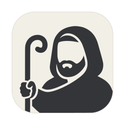

<h1 align="center"> Shepherd</h1>

When five Claude Code or Codex agents run at once, one of them is always waiting on you, and you find out by cycling through panes. Shepherd lists every agent with its status and how long it has waited, notifies you when one needs an answer, and lets you approve it from the notification.

It's a native app for macOS and Linux on top of [herdr](https://herdr.dev), which runs your shells and agents in workspaces, tabs and panes. Shepherd shows the same session with a sidebar and real tabs.

It's written in Rust on [GPUI](https://github.com/zeronsh/zui) and styled after [Zeron](https://github.com/zeronsh/zeron). The terminal is [libghostty-vt](https://github.com/ghostty-org/ghostty) with its own glyph renderer.

https://github.com/user-attachments/assets/9b3f5fae-8eee-4697-89b4-37d232250117

## What it does

- The sidebar lists workspaces. A repo's worktrees fold under it with their branch, changes against main and PR state. Right-click creates, opens or removes a worktree.
- Under the sidebar, herdr sessions and saved SSH machines sit in a bar, like Arc's spaces. A two-finger swipe goes to the next one. The bar is herdr's: Shepherd shows one backend at a time, and another backend's sessions are its workspaces.
- The agents list at the bottom shows every agent herdr detects in any workspace, with its status (working, blocked, done, idle), the task in its title and how long it has waited. Click one to jump to its pane.
- When an agent you can't see starts waiting or finishes, macOS shows a notification and the Dock icon counts it until you look at that tab. Approve on the notification answers the agent without opening Shepherd.
- Tabs show what runs in their panes: an agent, or a program such as Neovim, `cargo` or `btop`, each with its logo. Drag tabs to reorder them. Drag a pane by its grip onto another pane to split or swap, or onto a tab to move it there.
- Dividers between panes snap to the cell grid herdr lays out, and the terminal reflows while you drag.
- The terminal draws ligatures, Kitty images and box drawing on its own. Shepherd reads scrollback from herdr once and scrolls it locally. `⌘`-click opens links, files, folders and images.
- herdr's own `[keys]` work in Shepherd, and its popups float over the panes.
- `⌥⌘B` opens the review panel: the branch's PR (gh) or MR (glab) with its description, checks or pipeline jobs and their logs. It works for SSH machines too.
- Web pages (Settings → Web pages) list local tools, such as a dev server or a dashboard, above the workspaces. A click shows the page in the system web view in place of the tabs and panes, and it keeps its state while hidden. A page can be listed in one place only, and opened on the machine shown, through an SSH forward.
- `⌘K` opens a command panel with every action, workspace and tab. `⇧⌘A` opens the agents panel.
- The status bar shows the branch, its PR and CI, the current folder, the focused agent and your Claude and Codex plan limits.
- Settings cover fonts, themes, key bindings and usage. They also edit herdr's own `config.toml` for notifications and integrations, keeping your comments.

## Install

Download `Shepherd-<version>-universal.dmg` from [Releases](https://github.com/freethinkel/shepherd/releases), open it and drag Shepherd to Applications. One build runs on Apple silicon and Intel Macs. It's signed and notarized, so Gatekeeper opens it without a prompt. The same app is also there as a zip.

### Linux

The same release has Shepherd for x86_64 and aarch64 as an `.rpm`, a `.deb` and a `tar.gz`:

```sh
sudo dnf install ./shepherd-<version>-1.<arch>.rpm      # Fedora
sudo apt install ./shepherd_<version>-1_<arch>.deb       # Debian, Ubuntu
tar -xzf Shepherd-<version>-linux-<arch>.tar.gz -C ~/.local   # anywhere else: bin, .desktop file and icon
```

It draws with Vulkan, so it needs a Vulkan driver (`mesa-vulkan-drivers`, which the packages recommend). Web pages need WebKitGTK 4.1 (`libwebkit2gtk-4.1-0`), which the packages depend on; with the tar.gz, install it yourself, or Shepherd won't start. On Wayland a web page opens in the browser. Linux gets no Dock badge, Secure Keyboard Entry or self-update: release builds only say in the sidebar that a new release is out, and a click opens its page. Settings live in `~/.config/shepherd`. Clicking a notification asks the compositor to raise the window. Some do, others only mark it for attention. The notification sound comes from the freedesktop sound theme, played by `canberra-gtk-play`, or by `paplay` if that's missing.
Settings → Appearance can make the window translucent (your compositor decides whether it's blurred), or hide Shepherd's window buttons when the window manager has its own or tiles windows. Right-clicking the titlebar opens the window manager's window menu.

### Requirements

Shepherd needs macOS 14 or later, or Linux. It talks to the herdr server over `~/.config/herdr/herdr.sock` and starts the server if nothing answers there. If herdr isn't installed, Shepherd downloads the build for your system from herdr.dev, checks its SHA-256 and puts it in `~/.local/bin`, as herdr's `install.sh` does. You can point it at another binary or socket in Settings.

### herdr-core

Shepherd can also run on [herdr-core](https://herdr.dev/core) (`hc`), the terminal runtime under the Herdr app, as an experiment. Switch from herdr to it and back in Settings → Backend, or with Switch backend in the command panel. Your herdr sessions keep running either way. That page also shows the core's version and templates, restarts or updates it, and edits its shell, history, wait and notes.

herdr-core has terminals, not workspaces, so the Herdr app keeps its spaces, tabs and splits in a document in the core, and Shepherd shares that document: what you open, move or close in one shows in the other. Focus and zoom stay each one's own, a tab holding a mod or a stack can only be rearranged in the app, and Shepherd keeps a copy of the app's document from before its first write, as `shepherd-herdr-app-backup`. Terminals no space holds show under Other terminals. Off (Settings → Backend → Sync with the Herdr app), Shepherd keeps its own layout, and shows the app's terminals grouped by their labels. Plugins, popups, Kitty images and resuming agents after a reboot are herdr's and don't work there. Worktrees do: Shepherd makes them with git in `~/.herdr/worktrees` and runs a project's commands from Settings → Worktrees itself, so there they run only while Shepherd is open. An agent shows its status only if it reports it (Claude Code and pi do).

### Rex

Shepherd can also run on [Rex](https://www.superlogical.com/rex/docs), as an experiment, on a Mac with Rex installed. Switch to it in Settings → Backend, or with Switch backend in the command panel. Shepherd starts Rex's server if nothing answers. That page also shows the server, `init.lua`, the agent skill, terminfo and hosts, reloads the config and sets up what is missing.

Shepherd shows the same sessions as Rex.app: a session is a workspace, a window a tab, a block a pane. A pane in Shepherd's front window sets its terminal's size, and Rex.app follows it until Shepherd goes to the background. Rex's floating layers don't show, a pane moves only within its session, and plugins, popups and Kitty images are herdr's. Worktrees work as on herdr-core, named with a Nerd Font branch icon and their repo in Rex's own list of sessions (` mono/fix-tabs`), and an agent shows its status only if it reports it.

### tmux

Shepherd can also run on tmux 3.2 or newer, as an experiment. Switch to it in Settings → Backend, or with Switch backend in the command panel.

Shepherd shows the same sessions as `tmux attach`: a session is a workspace, a window a tab, a pane a pane. tmux sizes a session's windows, so they take the room of the tab shown, a pane can be a cell wider than its place, and a terminal attached to the same session at another size makes the two take turns. A session stays where its name sorts it, a window linked into two sessions shows in the first, and plugins, popups and Kitty images are herdr's. Worktrees work as on herdr-core, and an agent shows its status once it reports it while Shepherd is open.

## Keys

| Keys | Action |
|---|---|
| `⌘T`, `⇧⌘W` | New tab, close tab |
| `⌘D`, `⇧⌘D` | Split right, split down |
| `⌘W` | Close pane |
| `⌥⌘` + arrows | Focus the pane in that direction |
| `⇧⌘↩` | Zoom the pane |
| `⌘1` … `⌘9`, `⇧⌘[`, `⇧⌘]` | Go to a tab, previous or next tab |
| `⌘↑`, `⌘↓` | Previous or next workspace |
| `⇧⌘N` | New workspace |
| `⌘B`, `⌥⌘B` | Toggle the sidebar, the review panel |
| `⌘K`, `⇧⌘A` | Command panel, agents panel |
| `⌘=`, `⌘-`, `⌘0` | Text size up, down, default |
| `⌘,` | Settings |

You can rebind any of them in Settings.

## Build

You need a recent stable Rust toolchain, Xcode's command line tools and [Zig 0.16](https://ziglang.org/download/), which builds libghostty-vt. Put `zig` on your `PATH` and run with `ZIG=zig`, or point `ZIG` at the binary. The path in `.cargo/config.toml` only fits one machine.

```sh
make run      # debug build, run as Shepherd.app
make test
make lint     # clippy, warnings as errors
make app      # target/release/Shepherd.app
make install  # copy it to /Applications
make dist     # universal zip and dmg in target/universal
make linux    # Linux tar.gz, deb and rpm in target/linux-dist, built in Docker
make help     # everything else
```

`make app` signs with the Developer ID certificate in your keychain if it finds one, and ad hoc otherwise. CI makes the releases. Bumping `version` in `Cargo.toml` on `main` builds, signs, notarizes and publishes one.

## License

MIT, see [LICENSE](LICENSE). Code and assets taken from Zeron (MIT) and the Geist fonts (SIL OFL 1.1) are listed in [assets/NOTICE](assets/NOTICE).
