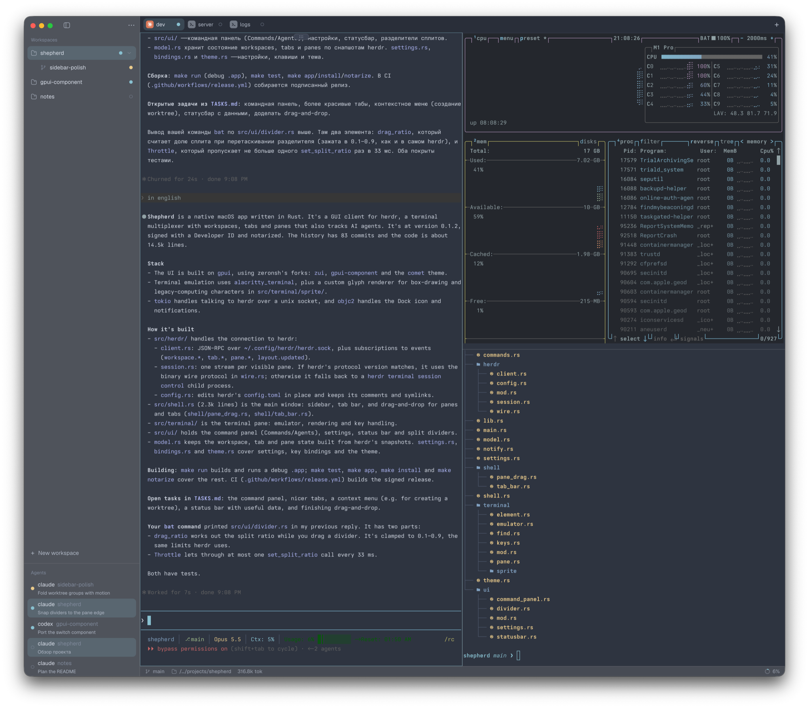

<h1 align="center"> Shepherd</h1>

A native macOS window for [herdr](https://herdr.dev). herdr runs your shells and coding agents in workspaces, tabs and panes. Shepherd shows the same session with a sidebar, real tabs and a list of every agent, so you can see which one is waiting on you without cycling through panes.

It's written in Rust on [GPUI](https://github.com/zeronsh/zui) and styled after [Zeron](https://github.com/zeronsh/zeron). The terminal is [libghostty-vt](https://github.com/ghostty-org/ghostty) with its own glyph renderer.



## What it does

- The sidebar lists workspaces. A repo's worktrees fold under it with their branch, changes against main and PR state. Right-click creates, opens or removes a worktree.
- Under the sidebar, herdr sessions and saved SSH machines sit in a bar, as Arc's spaces. A two-finger swipe goes to the next one.
- The agents list at the bottom shows every agent herdr detects in any workspace, with its status (working, blocked, done, idle), the task in its title and how long it has waited. Click one to jump to its pane.
- When an agent you can't see starts waiting or finishes, macOS shows a notification and the Dock icon counts it until you look at that tab. Approve on the notification answers the agent without opening Shepherd.
- Tabs show the agent or shell running in them. Drag tabs to reorder them. Drag a pane by its grip onto another pane to split or swap, or onto a tab to move it there.
- Dividers between panes snap to the cell grid herdr lays out, and the terminal reflows while you drag.
- The terminal draws ligatures, Kitty images and box drawing on its own. Scrollback is read from herdr once and scrolled locally. `⌘`-click opens links, files, folders and images.
- herdr's own `[keys]` work in Shepherd, and its popups float over the panes.
- `⌥⌘B` opens the review panel: the branch's PR (gh) or MR (glab) with its description, checks or pipeline jobs and their logs. It works for SSH machines too.
- `⌘K` opens a command panel with every action, workspace and tab. `⇧⌘A` opens the agents panel.
- The status bar shows the branch, its PR and CI, the current folder, the focused agent and your Claude and Codex plan limits.
- Settings cover fonts, themes, key bindings and usage. They also edit herdr's own `config.toml` for notifications and integrations, keeping your comments.

## Install

Download `Shepherd-<version>-universal.dmg` from [Releases](https://github.com/freethinkel/shepherd/releases), open it and drag Shepherd to Applications. One build runs on Apple silicon and Intel Macs. It's signed and notarized, so Gatekeeper opens it without a prompt. The same app is also there as a zip.

### Linux

The same release has Shepherd for x86_64 and aarch64 as an `.rpm`, a `.deb` and a `tar.gz`:

```sh
sudo dnf install ./shepherd-<version>-1.<arch>.rpm      # Fedora
sudo apt install ./shepherd_<version>-1_<arch>.deb       # Debian, Ubuntu
tar -xzf Shepherd-<version>-linux-<arch>.tar.gz -C ~/.local   # anywhere else: bin, .desktop file and icon
```

It draws with Vulkan, so it needs a Vulkan driver (`mesa-vulkan-drivers`, which the packages recommend). There's no
Dock badge, Secure Keyboard Entry or self-update on Linux: release builds only tell of a new release in the sidebar,
and a click opens its page; settings live in `~/.config/shepherd`. A click on a notification requests
activation for the window; compositors may grant it or mark the window for attention. The notification sound is the
freedesktop sound theme's, played by `canberra-gtk-play`, or `paplay` where that is missing.
Settings → Appearance can make the window translucent (whether it is blurred depends on your compositor), or hide its
own buttons when the window manager provides its own controls or tiles windows. A right-click on the titlebar opens the
window manager's window menu.

### Requirements

Shepherd needs macOS 14 or later (or Linux) and herdr. It talks to the herdr server over `~/.config/herdr/herdr.sock`, so herdr has to be installed and running. You can point it at another binary or socket in Settings.

## Keys

| Keys | Action |
|---|---|
| `⌘T`, `⇧⌘W` | New tab, close tab |
| `⌘D`, `⇧⌘D` | Split right, split down |
| `⌘W` | Close pane |
| `⌥⌘` + arrows | Focus the pane in that direction |
| `⇧⌘↩` | Zoom the pane |
| `⌘1` … `⌘9`, `⇧⌘[`, `⇧⌘]` | Go to a tab, previous or next tab |
| `⌘↑`, `⌘↓` | Previous or next workspace |
| `⇧⌘N` | New workspace |
| `⌘B`, `⌥⌘B` | Toggle the sidebar, the review panel |
| `⌘K`, `⇧⌘A` | Command panel, agents panel |
| `⌘=`, `⌘-`, `⌘0` | Text size up, down, default |
| `⌘,` | Settings |

Every binding can be changed in Settings.

## Build

You need a recent stable Rust toolchain, Xcode's command line tools and [Zig 0.16](https://ziglang.org/download/), which builds libghostty-vt. Put `zig` on your `PATH` and run with `ZIG=zig`, or point `ZIG` at the binary: `.cargo/config.toml` holds a local path that only fits one machine.

```sh
make run      # debug build, run as Shepherd.app
make test
make lint     # clippy, warnings as errors
make app      # target/release/Shepherd.app
make install  # copy it to /Applications
make dist     # universal zip and dmg in target/universal
make linux    # Linux tar.gz, deb and rpm in target/linux-dist, built in Docker
make help     # everything else
```

`make app` signs with the Developer ID certificate in your keychain if it finds one, and ad hoc otherwise. Releases come from CI: bumping `version` in `Cargo.toml` on `main` builds, signs, notarizes and publishes a new release.

## License

MIT, see [LICENSE](LICENSE). Code and assets taken from Zeron (MIT) and the Geist fonts (SIL OFL 1.1) are listed in [assets/NOTICE](assets/NOTICE).
